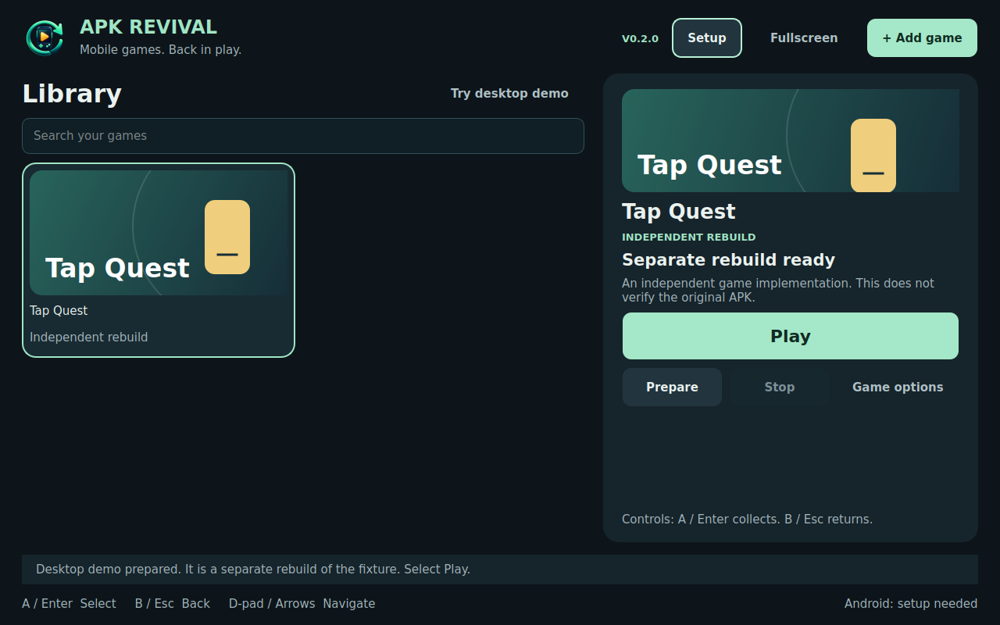
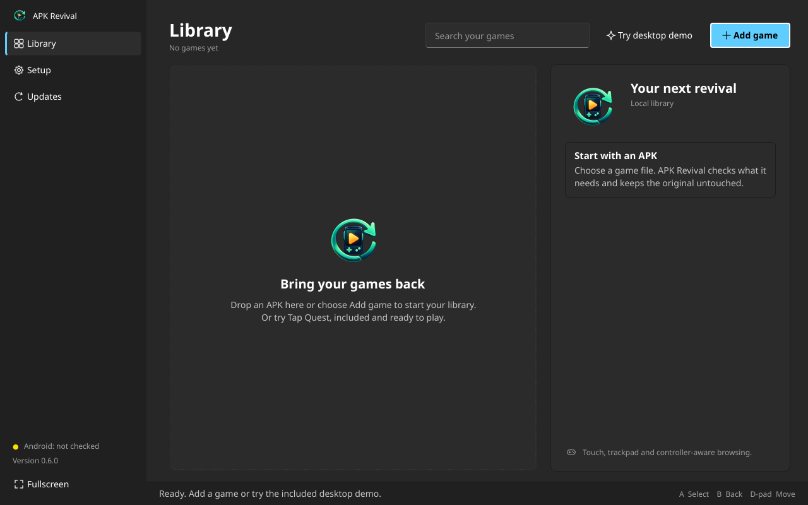
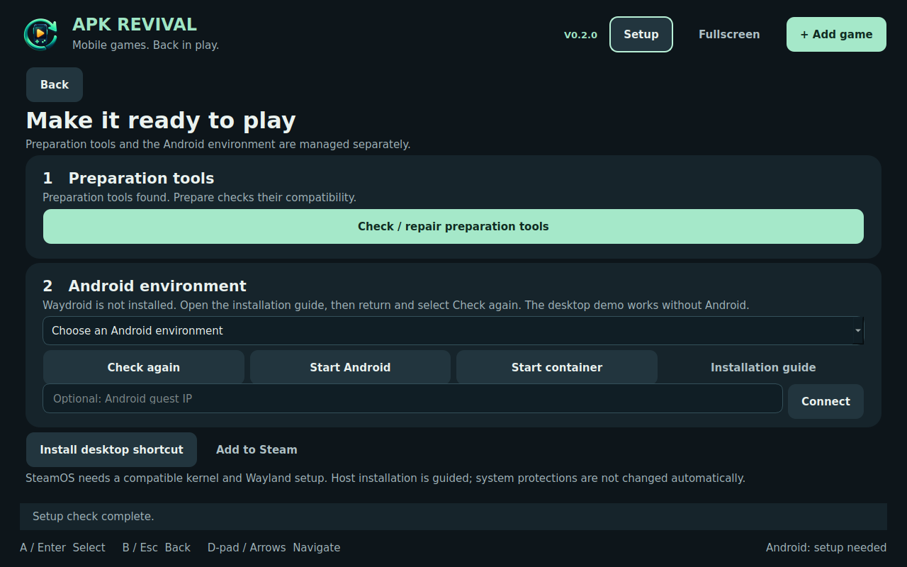
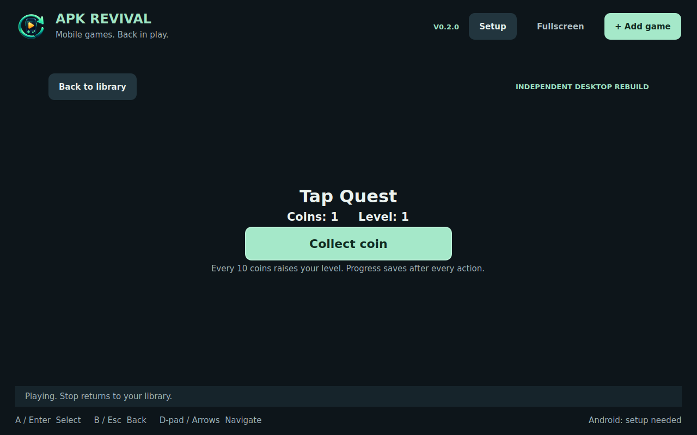
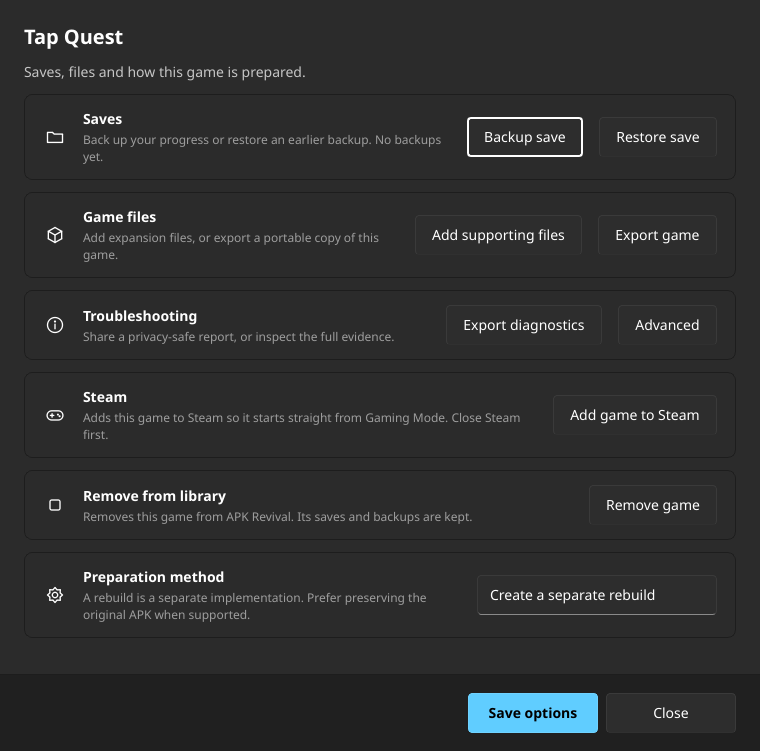
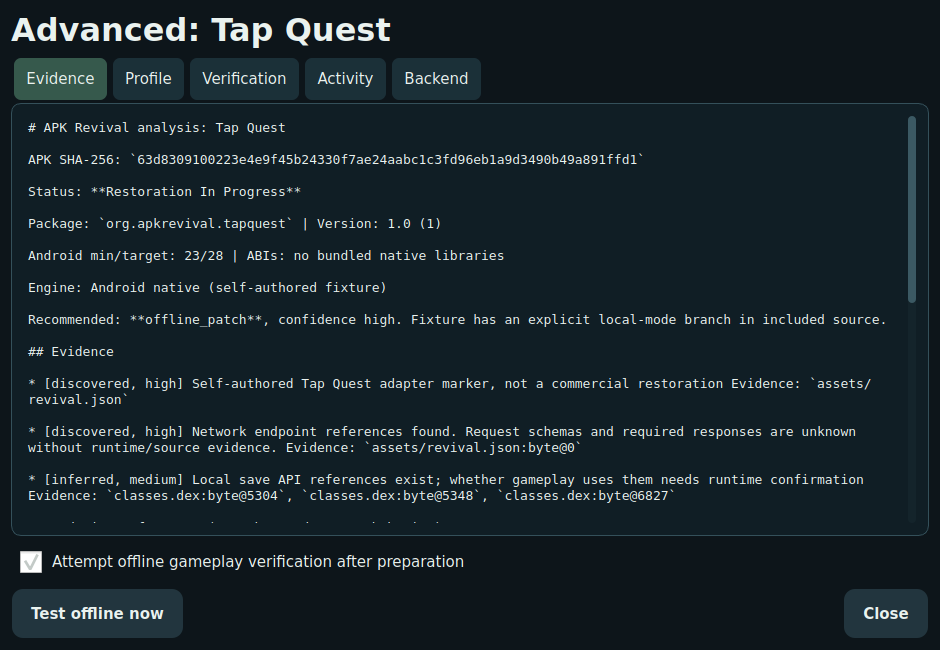

  

<h1 align="center">APK Revival</h1>

<strong>Your mobile games. Back in play.</strong>

  <a href="https://github.com/onlykappa/Apk-revival/releases">Download for Linux</a> ·
  <a href="CHANGELOG.md">Version history</a> ·
  <a href="docs/INSTALL_V2.md">Steam Deck setup</a>

  
  
  
  

A small local Android-game launcher for Linux and Steam Deck: **Add Game → Prepare → Play**. V2 provides a native fullscreen library, setup, background preparation, launch management, saves and exports around the V1 restoration engine.

## Open the app

Download **APK-Revival-0.2.0-linux-x86_64.tar.gz** from [Releases](https://github.com/onlykappa/Apk-revival/releases), extract it in Desktop Mode and double-click **APK-Revival**. In **Setup**, choose **Install desktop shortcut**. No Python installation or terminal is needed for the launcher. This build requires glibc 2.39 or newer; actual Steam Deck hardware compatibility still needs testing.

Choose **Try desktop demo**, then **Play** to try the included self-authored Tap Quest rebuild immediately. Collect coins and relaunch to see saved progress. It needs no Android runtime. It is a separate implementation, not proof that the original APK works offline.

For APK games, use **Add Game**, attach available supporting files, and **Prepare**. Setup guides preparation tools and Waydroid connection. Waydroid itself must be configured for your SteamOS version. APK Revival never disables SteamOS protections or silently installs privileged packages.

[Installation and adding to Steam](docs/INSTALL_V2.md) · [Observed test results](docs/TEST_RESULTS_V2.md) · [Contributor setup](docs/CONTRIBUTING_V2.md)

## Inside the app

These are screenshots of the running native application using the self-authored fixture. No commercial game restoration or Android gameplay is implied.

Home and first-run setup

Play, saves, exports and evidence

See [release history and update instructions](docs/RELEASES.md). V1’s **0.1.0** milestone remains in the changelog and original commit; the published V2 release is **v0.2.0**. These are early previews while Android and Steam Deck hardware verification remains outstanding.

## What works

* Native 1280 × 800 library, local artwork, touch/mouse/keyboard navigation and SDL2 controller focus navigation.
* Background import, analysis and actual preparation using V1 services and hash/version-bound profiles.
* All three self-authored fixture paths: signed offline patch, persistent local backend and independent rebuild.
* Guided runtime discovery, intended-device selection, compatibility checks, owned launch/stop cleanup and backend guest reachability checks.
* Adapter-backed save backup/restore, redacted diagnostics, evidence under Advanced and native portable exports.
* User-local installation, rollback copy and Steam non-Steam shortcut instructions.

Unknown games stop with a clear request for a restoration adapter or additional evidence. A changed URL, valid signature or launched activity never implies offline gameplay. **Imported, Prepared, Launch tested and Verified Offline are separate.** No V2 Android gameplay was verified in the build environment, and no commercial game restoration is claimed.

## Architecture and reuse

V1 remains the engine; its CLI and optional legacy Tk workbench remain available. V2 uses PySide6 rather than duplicating engine logic. OmniPC was inspected read-only, with MIT-licensed controller, focus, job-stage and launch ownership patterns adapted. Its Windows-specific backend was not copied or modified. See [V2 architecture](docs/ARCHITECTURE_V2.md), [V1 workbench](docs/V1_WORKBENCH.md), [adapters](docs/ADAPTERS.md) and [verification](docs/VERIFICATION.md).

Private originals, assets, saves and signing keys live outside the repository. Core analysis works locally without AI or an API key. The packaged launcher includes replaceable Qt libraries; upstream notices are in [resources](resources/THIRD_PARTY_LICENSES.md).

## First real game: files needed

Supply the exact base APK, title/version and where startup fails; matching split APKs and OBBs; available downloaded asset/cache folders; optional clean save and save location; launch/crash logs and screenshots; any available source or documented protocol examples; and your SteamOS/Waydroid version, guest architecture and ARM translation details. Redact credentials and tokens. Signing keys are not needed for analysis.

Missing server code or assets may make restoration impractical. Prefer the smallest supported change preserving gameplay; rebuilding requires a feasibility assessment and remains a separate result.
