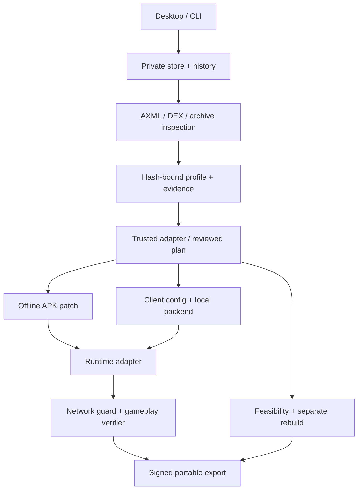

# Architecture

Python 3.10+ standard library. Tk is the desktop shell; the same application services power the CLI and portable exports. No hosted API or AI model is involved.

## Modules

| Module | Responsibility |
|---|---|
| `store.py` | Import copies, input SHA-256, roles, immutable-by-policy originals, revision snapshots |
| `analysis.py` | Compiled AXML and DEX string table parsing, metadata, reference evidence, conservative recommendations |
| `adapters.py` | Trusted game adapters, plans, recovered behavior and feasibility |
| `restoration.py` | Exact preconditions, patches, diffs, APK rebuilding, alignment, signing and verification |
| `backend.py` | Fixture-only documented protocol, serialized progression, atomic save persistence |
| `runtime.py` | Explicit ADB target, Waydroid diagnostics, ABI/API checks, installs, OBBs, forwarding, lifecycle and network guard |
| `verification.py` | Game-specific gameplay checks and fail-closed status gate |
| `saves.py` | Adapter-specific backups, cross-version rejection and reversible restore |
| `exporter.py` / `portable.py` | Portable packages, exclusions, integrity inventory and local launch |
| `ui.py` / `cli.py` | Native interface and command entry points |

## Private store

Default `~/.local/share/apk-revival` is outside the Git checkout. Each imported base APK has a directory under `games/<first-24-hex-of-SHA256>`. Every profile also carries the full hash; a collision is rejected rather than silently merged.

* `originals/`: byte-preserved inputs with hashes. Read-only file mode is a convenience; hash checks are the real consistency guard.
* `profile.json`, `history/`: versioned current state and immutable-by-policy revision records.
* `analysis.json`, `analysis.md`: evidence, confidence, hypotheses, inventory and next steps.
* `plan-*.json`, `work/<attempt>/`: explicit plans, isolated working files, diffs, signature checks and artifacts. Failed attempts remain reviewable.
* `saves/`, `backups/`: private progression and version-bound backup ZIPs.
* `diagnostics/`, `verification-artifacts/`: local logs and exact runtime verification records.
* `signing/`: private local signing identity and mode-0600 password, never exported or committed.

The source repository's ignore rules reject APK/OBB bundles, signing secrets, build outputs and userdata. Keep a custom `--data` root outside the checkout. Git ignore rules are not a replacement for reviewing what is staged.

## State and evidence

Imported -> Analyzed (fixture adapter) / Needs Evidence (unknown game) -> Restoration In Progress -> Exported but Unverified -> Verified Offline, only after required Android gameplay checks.

Analyzing again invalidates verification. Preparing a new artifact clears verification. Changing a backend port invalidates an already prepared backend client. A profile, plan, backup or result from another APK version does not silently transfer. Exported metadata includes the exact artifact SHA-256. Rebuilds keep separate feasibility/progress and cannot certify the original APK.

The application uses one desktop job at a time. Profiles are atomic JSON writes; **multiple concurrent workbench processes sharing one private store are unsupported**. The backend uses locks and atomic JSON for concurrent request handling. A desktop job never opens a network endpoint discovered in an APK.

## Runtime boundary

`WaydroidRuntime` separates client installation, compatibility checks, start/stop, log collection, forwarding, health probes and gameplay interaction. A future adapter can replace these operations for another Android environment. The verification implementation requires root inside the guest; no host firewall commands or automatic Waydroid installation occur.

A backend is bound to host loopback. `adb reverse --no-rebind` creates a guest loopback route without stealing an existing mapping. A fresh nonce returned by guest `toybox nc` proves it reached this backend instance. Forwarding and backend shutdown are tied to the launcher lifecycle. The independent rebuild needs no Android runtime.

## Reproducibility limits

Plans are reproducible logical transformations with exact preconditions. Signing keys and ZIP timestamps mean builds are not promised byte-for-byte identical. The user's local signing identity is reused for later exports. External tools can reject unsupported resources/framework versions; a successful tool exit is followed by manifest identity, alignment and signature checks, never substituted for gameplay verification.

